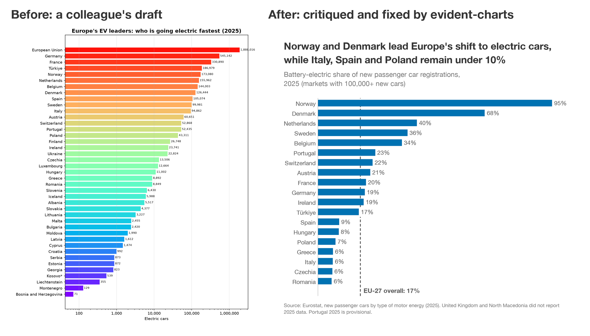

# evident-charts

Helps Claude make clear, honest charts and critique the ones you share.



<sub>Left: a typical draft, with raw counts on a log scale, the EU total ranked among its own members, and rainbow colors that mean nothing. Right: the same data after evident-charts critiqued and rebuilt it.</sub>

## Use

Ask for a chart the way you already do. Claude can load the skill when it makes or reviews a data chart.

```text
Chart sales.csv for a LinkedIn post on which regions grew fastest.
Make one slide showing where our budget went last year.
Critique this chart and fix it.        (attach the PNG, the script, or both)
```

## What it does

- Checks the data for totals mixed with their parts, duplicate rows, and placeholder values.
- Chooses a chart that fits the point you want to make.
- Writes the takeaway as the title and cites the data publisher.
- Reviews the rendered image for misleading axes, overlapping labels, and color problems, for up to 3 rounds.
- Returns ranked fixes when you ask for a critique, and reports anything it could not check.

## This edition

This is the edition listed in Claude's plugin directory. It holds only instructions and reference data and runs no code of its own. Claude checks each chart by looking at the rendered image, which needs a host that can view images.

The [full edition on GitHub](https://github.com/rhiever/evident-charts) adds Python scripts that measure label overlap, contrast, and color-blind safety. Install either edition, not both.

## How the rules work

Each rule has a tag: `[E]` experimental evidence, `[P]` practitioner consensus, or `[T]` taste. Your instructions take precedence, and Claude reports any deviations you asked for. Your project's style guide can replace the default look. Citations are in [`references/sources.md`](skills/evident-charts/references/sources.md).

## License

[MIT](LICENSE). Built by [Randy Olson](https://randalolson.com).
